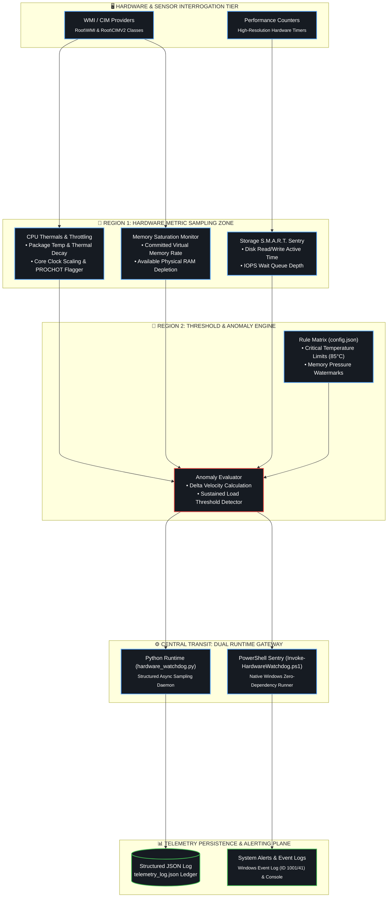

<div align="center">

# 🐕 HardwareWatchdog

### Background Hardware Sentry, Thermal Throttling Monitor & Reliability Watchdog
**PowerShell 7+ • Python 3.10+ • WMI / CIM Sensor Interrogation • Structured JSON Telemetry**

<p align="center">
  <em>Lightweight, non-intrusive hardware sentinel monitoring thermal dissipation, core clock throttling, and memory saturation in real time.</em>
</p>

<!-- Badges -->
<p align="center">
  <a href="https://www.python.org/downloads/"></a>
  <a href="https://learn.microsoft.com/en-us/powershell/"></a>
  <a href="https://coderabbit.ai"></a>
  <a href="LICENSE"></a>
</p>

<p align="center">
  
  
  
</p>

---

</div>

## 📌 Architecture & Sentry Loop



---

## ⚡ Key Capabilities

* **Dual Engine Architecture:** Runs either natively via Python (`hardware_watchdog.py`) or as a standalone zero-dependency PowerShell script (`Invoke-HardwareWatchdog.ps1`).
* **Thermal Throttling Protection:** Immediately flags CPU frequency throttling and thermal breaches before system instabilities occur.
* **Low Impact Operation:** Designed for 24/7 background monitoring with zero measurable performance degradation.

---

## 🖥️ Live Telemetry Preview

```
================================================================================
  HardwareWatchdog Sentry ─ [MONITORING ACTIVE]
================================================================================
  [SAMPLE RATE] 5s  │  [LOG DESTINATION] telemetry_log.json
--------------------------------------------------------------------------------
  [23:59:10] CPU: 42°C (Optimal) │ Core Clock: 4.80 GHz │ Load: 18%
  [23:59:15] RAM: 48% (15.4 / 32.0 GB) │ Memory Pressure: Normal
  [23:59:20] NVMe: 38°C │ Active Time: 3% │ SMART State: HEALTHY
================================================================================
```

---

## 🚀 Quickstart

```powershell
# Clone the repository
git clone https://github.com/Anudeep-Adari/HardwareWatchdog.git
cd HardwareWatchdog

# Option A: Run via Python
pip install psutil
python hardware_watchdog.py

# Option B: Run natively via PowerShell
.\Invoke-HardwareWatchdog.ps1
```

---

<div align="center">

Crafted with high engineering precision by **[Anudeep Adari](https://github.com/Anudeep-Adari)**  
Continuous AI Code Reviews powered by **CodeRabbit**

</div>

